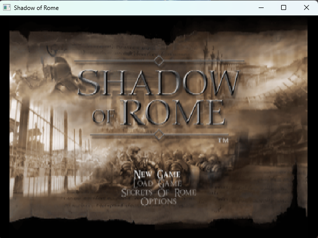

<p align="center">
  
</p>

<h1 align="center">Shadow of Rome Recompiled</h1>

Native PC port of Shadow of Rome (PS2) through static recompilation.

<p align="center">
  
</p>

**Boots to the main menu on Windows. Gameplay does not work yet (stops after New Game).**

This is an experiment. I can't promise I'll finish it, for personal reasons, and it will take a long time before the game is playable: I work on it with limited time and resources, so there are no deadlines.

If someone is already working on a port of this game, or is further ahead, please let me know as soon as possible by opening an [issue](../../issues), so I don't do useless work and can spend my time on something that hasn't been done yet.

You need your own legal copy of the game (PAL SLES-52950). No game files are included.

## Made with AI

This work was done with the help of AI: Claude (by Anthropic), guided by Francesco ([Korvonordico](https://github.com/Korvonordico)). Claude wrote most of the code, the scripts and the patches, and ran the tests.

It is not a one-off prompt. Claude runs inside [Hermes](https://github.com/NousResearch/hermes-agent), an agent platform I configured myself: a personal setup with my own skills, rules, notes and safety checks, built up over time. What that setup did for this port:

- a skill for PS2 game porting, written from my earlier port attempts, so the agent follows tested steps instead of guessing;
- [Quotient](https://github.com/Korvonordico/quotient-claude-tokens), my own tool to estimate, split and schedule long jobs: reaching the menu took 4 planned sessions, about 15 million weighted tokens;
- written handoff notes after every session, so each one starts from where the last one stopped.

The work is planned in steps, every step is tested on the real game, and I decide what goes on and what gets published.

## Status

**What works**

- The whole executable is translated to C++ and built for Windows, with no errors.
- All the game's original IOP modules load and run in PS2Recomp's IOP simulator.
- The game reaches, on screen: the controller notice, the language choice, the memory card check, the violence warning, the CAPCOM logo, the title screen, the main menu and the difficulty choice.
- About 24 frames per second at the main menu (measured on one PC).

<p align="center">
  
  
</p>

**What does not work, or is not checked**

- **Gameplay:** after New Game and the difficulty choice, within about 20 seconds, the thread that reads the disc dies (`cbTimerHandler` jumps to address 0). The game starts loading, but the first 3D scene has never been seen.
- **Movies are skipped on purpose:** this build has no FFmpeg, so the opening movie does not play.
- **Sound is not checked:** the sound driver runs in the simulator, but nobody has checked whether you can hear anything.
- **Saving probably fails:** "Create a save file" went back to "No data present". "Begin game anyway" works.
- **Keyboard and real controllers are not tested by hand:** all the tests so far used scripted key presses (`SOR_TASTI`). The keys below come from the code.
- **It has run on one PC only** (Windows 11, Intel i5-8600K).

## What you need

- Your own image of the disc: Shadow of Rome, PAL, SLES-52950, as an `.iso` file.
- Windows 10 or 11 (64-bit), with [WSL](https://learn.microsoft.com/windows/wsl/install) and Ubuntu. Tested on Windows 11 with Ubuntu 26.04.
- A CPU with SSE4.1 (nearly every PC since about 2009), and about 2 GB of free disk space.
- In Ubuntu: Git, CMake 3.24 or newer, a C++ compiler and Python 3.11 or newer:

  ```bash
  sudo apt install build-essential cmake git python3
  ```

- [llvm-mingw](https://github.com/mstorsjo/llvm-mingw/releases), the compiler for Windows: download the `ucrt-ubuntu` `x86_64` archive and unpack it, then rename its folder to `~/llvm-mingw`. Tested with clang 23.1.4. If you keep it somewhere else, set the `LLVM_MINGW` variable to its folder.

## How to build

Run these in the Ubuntu terminal.

1. Go to a folder on a Windows drive, so that Windows can start the game from there, and download the project with its submodule:

   ```bash
   cd /mnt/c/Users/YOUR_NAME
   git clone --recurse-submodules https://github.com/Korvonordico/shadow-of-rome-recompiled.git
   cd shadow-of-rome-recompiled
   ```

2. Build everything from your disc image. In WSL, `C:\Games\game.iso` is written `/mnt/c/Games/game.iso`:

   ```bash
   scripts/setup.sh "/mnt/c/Games/game.iso"
   ```

   This takes about 15 minutes on a 6-core PC. It patches PS2Recomp and builds its tools, reads the executable and the IOP modules from your image, makes the function map from the executable's own debug information, translates the game to C++ and builds `_build/sor.exe`. If the build fails, the reason is at the end of `_build.log`.

Nothing it creates is committed to Git: `disco/`, `mappa/`, `analisi/`, `gen/`, `_tools/` and `_build/` stay on your PC. The game's large files are not copied: they are read from your image while you play, so keep the image where it is.

## How to start it

- **From Windows:** drag your `.iso` file onto `run.bat`.
- **Or from the Ubuntu terminal:**

  ```bash
  scripts/run.sh "/mnt/c/Games/game.iso"
  ```

Close it with the X of the window.

## Keys

If no controller is connected, use the keyboard:

| PS2 | Keyboard |
|---|---|
| D-pad | Arrow keys or W A S D |
| ✕ | X or Space |
| ○ | C |
| ▢ | Z |
| △ | V |
| L1 / R1 | Q / E |
| L2 / R2 | Left Shift / Right Shift |
| Start | Enter |
| Select | Tab |

Esc also counts as ○, but it is the default key of the window library (raylib) for closing the window, so use C.

## From the start to the menu

1. Press Enter, then X to choose the language, then X on Start Game.
2. Press X until you see "Begin game anyway?", press the left arrow to choose Yes, then X. If the memory card check comes back, that is normal: do it again.
3. After the CAPCOM logo, press Enter at the title screen.

## How it works

[PS2Recomp](https://github.com/ran-j/PS2Recomp) rewrites each instruction of the PS2 executable as C++. That C++ is then built for Windows together with a runtime that plays the part of the rest of the console: memory, operating system, disc reader, graphics, sound and I/O processor. The game's original code runs, translated; it is not rewritten by hand.

- `pc/`: our part of the program, and the build files.
- `strumenti/` ("tools"): Python scripts that read the disc and make the function map.
- `patches/`: our changes to PS2Recomp, each one explained in [patches/README.md](patches/README.md).
- `thirdparty/PS2Recomp`: the PS2Recomp submodule, at the commit we use.
- `scripts/`: the scripts to build and start the game.

Many names and comments in the code are in Italian. `pc/prova.sh` is the quick round used during development.

## Credits

- [ran-j/PS2Recomp](https://github.com/ran-j/PS2Recomp), the recompiler and runtime this port is built on. We use upstream commit `e5636981` directly, with our patches, and no fork of it.
- [victor-takai/rogue-galaxy-recomp](https://github.com/victor-takai/rogue-galaxy-recomp), used as a reference for how to organize the project and for how to use PS2Recomp. It is built on [Sinan Karakaya's fork](https://github.com/Sinan-Karakaya/PS2Recomp) of PS2Recomp.
- [llvm-mingw](https://github.com/mstorsjo/llvm-mingw) by Martin Storsjö, the compiler used to build for Windows.

Shadow of Rome belongs to Capcom. The logo is the official Capcom logo, from the copy uploaded to [SteamGridDB](https://www.steamgriddb.com/logo/17719) by [DARTH-HMD](https://www.steamgriddb.com/profile/76561198842967508), with "Recompiled" added. If Capcom asks, it will be removed. This project is not connected to Capcom or Sony.

## License

GPL-3.0, the same as PS2Recomp, which the built program links. See [LICENSE](LICENSE).

---

If you'd like to support me, have a look at my other projects on my profile: [github.com/Korvonordico](https://github.com/Korvonordico).
