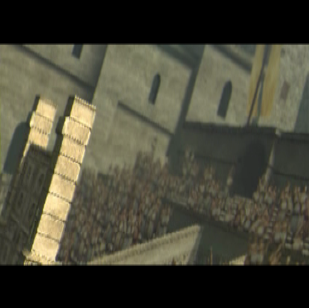
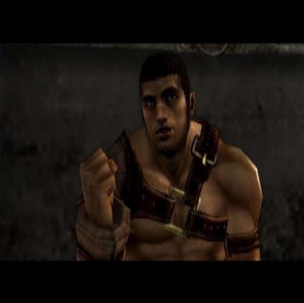
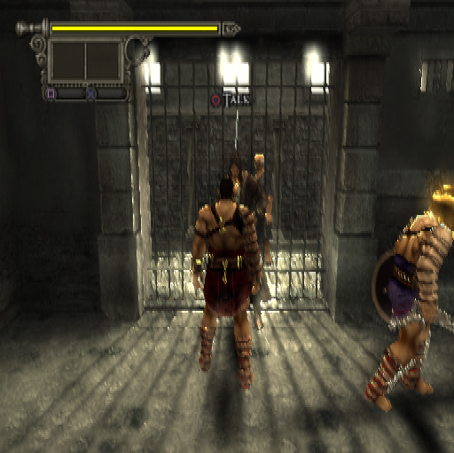
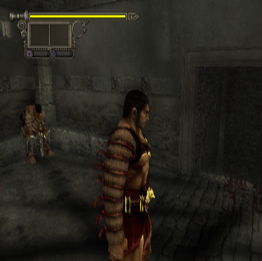

<p align="center">
  
</p>

<h1 align="center">Shadow of Rome Recompiled</h1>

<p align="center">An unofficial PC version of Shadow of Rome (PS2), made by translating the game's own code into a Windows program.</p>

<p align="center">Version 0.0.7 · <a href="CHANGELOG.md">What changed</a></p>

<p align="center">
  
</p>
<p align="center">
  <a href="docs/first-arena-by-hand.mp4">Watch one minute of the first arena, played by hand</a> (MP4, 9 MB, no sound)
</p>
<p align="center"><b>This is only a sample to show that the game starts and runs.</b> It is not fully playable yet: it still has many problems. The video was recorded before the camera fix, so in it the camera moves in close behind the shoulder, which it no longer does. See <a href="#status">Status</a> below.</p>

## What this is

[Shadow of Rome](https://en.wikipedia.org/wiki/Shadow_of_Rome) is an action game made by Capcom for the PlayStation 2 in 2005. Agrippa's father is accused of murdering Caesar: Agrippa is forced to fight as a gladiator in the arenas, and his friend Octavianus sneaks through Rome to find out who really killed Caesar.

This project makes it run on a Windows PC as a normal program. It is not an emulator. A tool called [PS2Recomp](https://github.com/ran-j/PS2Recomp) reads the game's program from the disc and rewrites every one of its instructions as C++ code, which is then built for Windows. This is called static recompilation. The parts of the PS2 that the game talks to (the graphics chip, the sound chip, the memory card, the disc drive) are played by a runtime that comes with PS2Recomp, with many fixes of mine (see [patches](patches/README.md)).

**You need your own copy of the game** (the European disc, PAL, SLES-52950), as an `.iso` file. No game data is included. The ready-made package on the [Releases](../../releases) page holds only the program: the game's code translated to C++ and built for Windows, and the launcher. The first time you press Play, the launcher reads the rest from your own disc image. You can also build the program yourself from your disc: see [How to get it running](#how-to-get-it-running).

This is an experiment. I can't promise I'll finish it, for personal reasons, and it will take a long time before the game is playable: I work on it with limited time and resources, so there are no deadlines.

If someone is already working on a port of this game, or is further ahead, please let me know as soon as possible by opening an [issue](../../issues), so I don't do useless work and can spend my time on something that hasn't been done yet. If you find a mistake here, even a small one, an issue is welcome too.

## The launcher

`ShadowOfRome.exe` starts the game in a window. **Play** starts it, **Quit** closes it. The first time, Play asks where your `.iso` file is, reads from it the files the game needs (a few seconds, into the `disco` folder next to the launcher) and remembers it. If the image is not the European disc, Play says so and starts nothing. Options, Graphics, Controls, Mods and Credits are shown greyed out as "coming soon". The version is in the bottom right corner.

<p align="center">
  
</p>

## Screenshots

In the order you meet them in the game: the title screen and the menus, two movies, the first arena, the cells under it and a fight.

<p align="center">
  
  
  
  
</p>
<p align="center">
  
  
  
  
</p>
<p align="center">
  
  
  
  
</p>

## Status

**In short:** the game starts, every menu works, the movies play, and the first arena can be played at full speed in a window. My test scripts have played on into Chapter 1, as far as the Germanian Forest. Nobody has played the whole game, and most of it has only been reached by test tricks.

Most checks below were done by **test scripts**: small programs that press the keys, read the game's memory and take screenshots. Where I played **by hand**, it says so. Some tests **forced** the game forward by writing to its memory (for example, to win a round without fighting it): those are marked too.

### How far the game goes

| Part of the game | State | How it was checked |
|---|---|---|
| Start: language, video mode, memory card, warnings, CAPCOM logo, opening movie, title screen | Works | Script, on screenshots. By hand too, on an older build that skipped the movies |
| Every menu: New Game, Load Game, Secrets of Rome, Options | Works | Script, on screenshots |
| The first arena (the First Match) | Works, at full speed (50 frames per second, like the European original) | By hand for a few minutes. A script played it to its end, with help (see below) |
| Saving and loading | Works | Script: saved after the First Match and after City Arena Round I (that win was forced), closed the game, loaded both |
| The movies after the first arena, and the "City Arena" title card | Work | By hand, from my own save |
| Chapter 1: the Roman camp in a forest | Can be finished | Script, with help |
| The Forum in Rome (Octavianus), then a street | Reached by walking | Script |
| The Germanian Forest (Agrippa) | Partly played. It froze once, after about 95 minutes. Two later runs, of 46 and 108 minutes, did not freeze | Script |
| The next areas: the fort key, the inside of the fort (053) | Played: the enemies die, and the game goes by itself to the next area (054) | Script, starting from a forced jump |
| The fort wall (054) | Loads and runs. The enemies on the ground die, but the big door does not open: two archers on the wall are left, and the script cannot reach them | Script |
| The two areas after it (055, 056) | Load and run | Script, each one reached by a forced jump |
| City Arena Rounds II and III, the first Octavianus stage | Load and run | Script, with each win forced |
| The rest of the story | Not played. Of 31 later stages tried, 30 load and run | Script, each one reached by a forced ending |

### What's new in 0.0.7

- **A ready-made package:** download it from [Releases](../../releases), unpack it, open `ShadowOfRome.exe`, press Play and choose your `.iso` file. No WSL, no tools, no build. The game itself is the same as in 0.0.6.

### What's new in 0.0.6

- **Fixed: a flat grey shape on the sand near the camera, in the arenas.** It was a hole in the floor: the game draws the parts closest to the camera in a separate way, and the translated code never told it which parts needed it. Patch `0017` in [patches/README.md](patches/README.md). Checked by script on screenshots: the shape is gone, and the speed is about the same (about 1 frame per second less, because more floor is drawn).
- **The launcher works from a fresh copy of the repository** (its build script was broken), shows its version, and says what is missing. The build now makes it by itself.
- All the changes: [CHANGELOG.md](CHANGELOG.md).

### Tested by hand

| When, which build | What I did | Result |
|---|---|---|
| 31 October 2026, before the speed work | From the desktop shortcut: menu, New Game, into the first arena | Works, but extremely slow |
| 31 October 2026, after the speed work | About three minutes in the first arena with a PS4 controller: walking and fighting (the video above) | Works |
| 2 November 2026, with patch `0016` | From my own save, past the "City Arena" title card, watched the movie and played on | Works. Seen, not fixed: glitches on the floor, and the speed is not steady (short slowdowns) |
| 0.0.6 | Not tested by hand yet | |

### What does not work yet

- **It is not playable from start to end.** Nobody has finished the game on it, and from the Germanian Forest on, nothing has been played without forcing.
- **A freeze in the Germanian Forest,** seen once, after about 95 minutes of play: the picture stopped and the game's logic stopped. Something wrote drawing data over most of the game's memory. The cause is not known. A later test spent 108 minutes in the same stage without freezing, but its script fought only in the first 15 minutes or so, and then walked back and forth.
- **Speed:** full speed (50 frames per second) in the first arena on my PC, but some later places are slower: in the next arena, a median of 32 frames per second. The drawing runs on the processor and needs its cores: with other programs busy, the game slows down. The game's 60 Hz mode can be chosen, but it does not hold 60 yet. Moving the drawing to the graphics card has not been started.
- **The picture:** the forests are very dark, and nobody has compared them with the real console. The glitches on the floor I saw by hand may be the grey shape fixed in 0.0.6: not checked by hand yet.
- **The sound** was listened to by hand only on an older build. The music and the movies' sound were checked as numbers on a recording, not by ear.
- **The launcher** has only Play and Quit.
- **The fights** were checked by a script that fights badly, not by a good player: whether they feel right can only be judged by playing.
- **It has run on one PC only** (Windows 11, Intel i5-8600K, 6 cores), with the keyboard and a PS4 controller.

<details>
<summary><b>All the test details</b></summary>

**What works**

- The whole executable is translated to C++ and built for Windows, with no errors.
- All the game's original IOP modules load and run in PS2Recomp's IOP simulator (the IOP is the PS2's second processor: it runs the sound, the disc and the memory cards).
- From the start to the menu, on screen: the language choice, Start Game and Change video mode (with the NTSC test), the memory card check, the violence warning, the CAPCOM logo, the title screen and the main menu.
- Every menu, opened and closed, checked on pictures:

| Menu | Works | Notes |
|---|---|---|
| New Game | Yes, up to the first arena | See below |
| Load Game | Yes | It finds a game saved after City Arena Round I and loads it. With no game saved it says "No data present": the file made at startup is not a game in progress |
| Secrets of Rome | Yes | Cheats and the Salvo Master List with its pages open and close. The other 6 entries are locked, as on a new game |
| Options: Subtitles / Tutorial, Sound, Controller, Violence | Yes | Each value changed and put back |
| Options: Screen | Yes | Brightness and Screen Position pages |
| Options: Control Explanation | Yes | All 3 pages |
| Options: Default, OK | Yes | Default puts the changed values back |

- **The first arena, in 3D:** after New Game and the difficulty choice come the trainer's briefing, the "First Match" map, the controls page, then Agrippa at the gate of the City Arena. Checked on pictures, with scripted keys.
- **Saving and loading:** the game saves after the First Match ("First Battle - Fini", see below) and offers to save after City Arena Round I. Tested on City Arena Round I: "Save Successful", the game closed and opened again, Load Game finds "City Arena Round I", "Load Successful", and the game goes on from City Arena Round II. **The win was forced by writing to the game's memory in the test:** nobody has won that round by playing yet. Starting from an empty memory card also works, both when you create the save file at the start and when you skip it and save later (that second way was followed up to the last confirmation). The saves are in `disco/mc0/`.
- **The 60 Hz choice is remembered:** after you choose it in Change video mode and press Start Game, the game writes `settings.ini` next to `sor.exe`, and the next start begins in that mode. See [Settings](#settings). Tested with scripted keys, not yet from the launcher.
- The keyboard, with real key presses sent to the window by a script (Enter, the down, left and right arrows, Space, X, V). The arrow keys and W A S D move the left stick, and with them Agrippa walks in the first arena (checked with keys injected inside the program, not on a real keyboard).
- **Speed at 50 Hz, the game's PAL mode (the European version):** full speed from the menu to the fight, in a window, on the test PC with nothing else running. Measured in vblanks per second, which here means frames per second: 50 is full speed. The earlier build is on the same PC:

| Part | Earlier build | Now | Lowest second now |
|---|---|---|---|
| Menu | 50 | 50 | 49.9 |
| Trainer's briefing | 43 | 50 | 42.6 (one second, once) |
| First room | 41.8 | 50 | 49.7 |
| Arena | 36.9 | 49.9 | 49.8 |
| Fight | 37 | 50 | 49.9 |

- **The sound:** I listened to it by hand on an older build: it sounds fairly good. The sound mix has changed since (see the reverb below) and has not been listened to again.
- **The music:** the title screen, the menu and the arena have their music. Checked as numbers on a recording of the output, not by ear: the level goes from silence to about 3000-4000 RMS on the title screen and in the menu, with no clipping. In 30 seconds of title music, the short holes of exact silence went from 155 to 0.
- **The movies:** the opening movie plays with its subtitles and sound, 30 pictures per second at 50 Hz and at 60 Hz, and goes on to the title screen at its end. Enter skips it. The title screen's attract movie and the movie after New Game play too. Checked on pictures and as numbers on a recording of the output (all 178 seconds of sound, with no holes in a 60-second sample), not by ear. They are decoded with a small part of [FFmpeg](https://ffmpeg.org), and the picture reaches the screen as a texture, as in the original game. From the second movie on, the sound used to break and the screen stayed grey with a beep after the "City Arena" title card: fixed on 2 November (patch `0016`), and tested by hand.
- **The First Match, played to its end:** this win was not forced. A test script (not published) reads positions and life from the game's memory and presses the keys: it walks to the enemies, hits them, closes the tutorial pages and opens the doors with ○. All the waves die, including the last opponent (2816 life), and the game does the rest by itself: result screen, save, "Chapter 1: The Wickedness of Men", and the next stage, a Roman camp in a forest (area 050). Load Game then finds the save as "First Battle - Fini" and goes on to Chapter 1, even after closing the game. **The script had help:** it refilled Agrippa's life 18 times when it fell below 500 of 2048, because it fights badly and never guards. So nobody has won this fight without help yet. Without the refill, in one attempt Agrippa died with 1 enemy of the first group left, and in another he had 39 life left when that group was dead. The Game Over works: blood runs down the screen and Continue goes back to the waiting room. Over that whole session the median was 50 frames per second, and 5% of the seconds, loading included, were below 33 (not looked into).
- **The forest stage, played to its end, and what comes after:** this was not forced either, and the same script played it, with the same kind of help (Agrippa's life refilled once). The stage asks you to climb the hill at the far end of the camp, talk twice to the soldier by the fence, and choose "Inform the men that we are moving out." in his menu. If you press ✕ without moving down, the menu answers "Nothing, yet." and nothing happens. Then enemies appear; when they are dead, the game goes by itself to the Forum in Rome, with Octavianus, then to a street leading to the Senate House, then to the Germanian Forest with Agrippa. That is the order the game's own story follows. The tests skipped movies, so the Senate House was not seen: it may be a movie. The Germanian Forest has not been finished: the script fought through part of it and climbed a ladder (ladders work), then **the game froze**, with the same picture staying on the screen and the game's logic stopped. Something had written drawing data over most of the game's memory, starting at address 0x4000; the cause has not been found, and it has happened once, after about 95 minutes of play. Later tests did not freeze: about 30 minutes from a forced jump to the upper walkway, 46 minutes of fighting in the stage, and 108 minutes in the stage (the script fought for the first 15 minutes or so, then walked back and forth; median 49.9 frames per second, 0.5% of the seconds below 40). From the walkway ○ on a door leads to the next area (052), where the script killed the enemy and picked up the "Germanic Tribe Fort Key". With that key, ○ opens the fort's door and the game goes by itself to the inside of the fort (area 053), reached only this way so far. The picture in the forests is very dark: it has not been compared with the original.
- **The fort (areas 053 to 056), reached by a forced jump to 053:** in 053 the script killed two enemies, then two more came, and when they were dead the game went by itself to the next area (054), the fort wall. There the enemies on the ground die, but ○ does not open the big door: two archers stand on the wall, and the script cannot reach them. Moving Agrippa next to them by writing to the game's memory did not settle it: next to the first archer, that archer left the game's list of enemies; next to the second one, the move did not hold; walking on the wall with no life refill, Agrippa died, and Continue went back to area 050. The next two areas, 055 (behind that door, 12 enemies: the script killed none of them in 4.5 minutes) and 056, were reached only by forced jumps: they load and run, and the screenshots of 054 and 055 look right. Speed, one run each: a median of 49.9 frames per second in 053 to 056, with 1.6 to 2.3% of the seconds below 40. So 053 to 054 has been played by a script, the rest has not been played.
- **The next arena, reached with one forced ending:** a different test forced only the end of the forest stage. The game then goes by itself to the waiting room, with a dialogue with the trainer, and after the script talks to the people there it goes on to the next arena (area 072), with 9 opponents and 4 statues. The script finished this fight with the same help (life refilled 24 times), and the game went back to the waiting room by itself. The story does not go there after the forest when played, so this only shows that the fight works. It is slow: a median of 32 frames per second in an earlier test, and 5% of the seconds below 20.
- **After the first arena:** with each win forced by writing to the game's memory (nobody has won these by playing), City Arena Rounds II and III and the first stage with Octavianus load and run at full speed, the game saves after each of them, and Octavianus walks with scripted keys. A forced win alone does not end the Octavianus stage: it asks to save and starts the stage again, because the game also needs to know which story point comes next (see below).
- **Later parts of the game, reached by jumping:** nobody has played this far. A test script writes to the game's memory to change area, the same way the game does it, without following the story. Of the first 93 areas tried, most load and show the place, including the chariot race, the forest camp and later arena fights, usually at or near full speed (9 were below 40 frames per second when measured). 10 stop on "Now Loading", 3 could not be entered, and in 1 the game closed by itself. A later round of 145 areas, after the 0.0.6 fix, stopped in the same places, except that one more area can now be entered and two no longer close the game. It is not known yet whether these are real bugs or come from the jump, which does not change the playable character. Water surfaces used to break the picture and slow the game to a few frames per second: that is fixed.
- **The story order, walked with forced endings:** nobody has played this far either. The game keeps a table of its story points, in order. A test script writes a point's number to the game's memory and forces the end of the stage, and from there the game does the rest by itself: result screen, save, the next area. The script also writes which character should be used next. 31 points were tried, from the first Octavianus stage to area 0c0. 30 of them reach their area and keep running, and the pictures checked show real dialogues, story pages and the right character. Most ran at 40-50 frames per second; the slowest measured were 24, 35 and 39, each measured once. One point (area 031, scene 14) stops while loading every time, even from a fresh start: it is not known yet whether that comes from the forced ending. Two points (the last ones in area 082) moved on to area 061 by themselves a few seconds later, and it is not known why. Stages were entered, not played, so this does not show that each one can be finished. Area 081 stopped on "Now Loading" when jumped to, but loads this way, so that stop seems to have come from the jump.
- **Long sessions:** the game could close by itself ("EE invocation stack space exhausted") after many area changes in one session. Each game thread that needed one got a small block of memory, there is room for only 64, and they were never given back. They are now reused when a thread is deleted: in two test sessions, 30 and 26 blocks were asked for and only 4 had to be new each time. Neither session asked for more than 64, so a very long session has not been tested on this.
- **The grey shape near the camera (fixed in 0.0.6):** with the fix, in the same scripted arena tests the shape is gone, and in one frame the sand went from 107 to 479 triangles. Speed, one run each: 47.9 frames per second instead of 48.4 on a walk with scripted keys, 44.3 instead of 45.5 in a scripted fight (the two fights were not identical).

**What does not work, or is not checked**

- **60 frames per second is not steady yet.** The game's own 60 Hz mode (Change video mode, the NTSC test) can be chosen and works. Two runs on the test PC: menu 60 and 60, trainer's briefing 59.9 and 57.9, first room 59 and 58, arena 43.9 and 50.9, fight 51.9 and 54.9. With the drawing switched off, every part holds about 60, so the drawing is what is missing: it runs on the processor and fills about 15 screens of pixels per frame. Steady 60 needs the drawing moved to the graphics card, which has not been started.
- **Speed needs the cores:** in the arena the drawing threads use 70-87% of their cores at 50 Hz. If other programs keep the processor busy, it will slow down. It has been measured on one PC only.
- **The camera:** it no longer jumps in close behind the shoulder, and the first scene, the first room and the arena now show the wider view. The cause was a wrong square root in PS2Recomp (see `0010` in [patches/README.md](patches/README.md)). The same scripted test, pressing ✕ in the first room: before, the camera moved from distance 101 to 526; now from 94 to 121. A second fix (`0011`, float to integer conversion that rounded instead of truncating) removed the bars that stood in front of the view in the arena. With both fixes, short drops appear in the first room and on the way to the arena (35 to 39 frames per second for 1 to 6 seconds): the cause has not been looked for. Tested with scripted keys and compared with the old build on screenshots, not against the original game on a PS2. The same fix changes every distance the game computes this way, so enemies may behave differently too: this has not been checked one by one.
- **Fighting is checked by a script, not by a skilled player:** a test script steers Agrippa with key presses and fights the whole First Match. Agrippa's life bar goes down when he is hit, enemies lose life and die, and weapons and shields can be picked up (seen on pictures and in the game's memory). Whether the fights feel right, and whether the timing is fair, can only be judged by someone playing. After the First Match the game used to freeze sometimes while loading the next round: garbage read as a position by the lock-on code made the wall check write outside its grid. That is fixed (see `0013` in [patches/README.md](patches/README.md)).
- **Reverb is written but not heard:** the game's own sound driver runs in the IOP simulator and drives a simulated SPU2 sound chip (48 voices, envelopes, DMA, streaming, reverb). In the first arena the game keeps the reverb's output volume at 0, so it changes nothing there. Forcing that volume in a test: no clipping and nothing runs away, and the sounds of the fight get up to about 15% stronger. Nobody has listened to it yet, and the zones where the game turns it on have not been reached.
- **A small difference left in the picture:** drawing on several threads and drawing strictly in order differ slightly (0.85% of the pixels by more than 16 out of 255, in the trainer's briefing). It has not been explained yet.

</details>

## How to get it running

### The easy way: the ready-made package

1. You need your own image of the disc: Shadow of Rome, PAL, SLES-52950, as an `.iso` file. If you have only the disc, copy it to an `.iso` file first, with a disc copying program on a PC with a DVD drive.
2. You need Windows 10 or 11, 64-bit, with a processor that has SSE4.1 (nearly every PC since about 2009). A processor with 6 cores or more is best: the game needs them to run at full speed.
3. Download `ShadowOfRome-0.0.7-windows.zip` from the [Releases](../../releases) page and unpack it into a folder of its own (right-click the file, "Extract all").
4. Open the folder and double-click `ShadowOfRome.exe`. Windows may warn that the program is not known: choose "More info", then "Run anyway".
5. Choose **Play** and pick your `.iso` file. The first time it reads the game's files from it, in a few seconds, then the game starts. Keep the image where it is: the game reads its large files from it while you play.

Saves and the files read from your disc stay in that folder. Close the game with the X of its window.

### Building it yourself

You build the game once, on your PC, from your own disc image. It takes some setting up, then one command does the rest. All of this was tested on one PC, with Windows 11 and Ubuntu 26.04.

#### What you need

- Your own image of the disc: Shadow of Rome, PAL, SLES-52950, as an `.iso` file. If you have only the disc, copy it to an `.iso` file first, with a disc copying program on a PC with a DVD drive.
- Windows 10 or 11, 64-bit, with a processor that has SSE4.1 (nearly every PC since about 2009). A processor with 6 cores or more is best: the game needs them to run at full speed.
- About 2 GB of free disk space, and an internet connection during the build (it downloads some code it needs, for example for the movies).
- WSL with Ubuntu: a Linux system inside Windows, made by Microsoft. The build runs there; the game then runs in Windows.

#### Step 1: install the tools (once)

1. Open PowerShell as administrator (right-click the Start button and choose "Terminal (Admin)", or "Windows PowerShell (Admin)" on Windows 10) and run:

   ```
   wsl --install
   ```

   Restart the PC when it asks. Then open **Ubuntu** from the Start menu and choose a user name and a password. More help: [Microsoft's guide](https://learn.microsoft.com/windows/wsl/install).

2. In the Ubuntu window, install Git, CMake, a C++ compiler and Python (it asks for the password you just chose):

   ```bash
   sudo apt update
   sudo apt install build-essential cmake git python3 wget
   ```

3. Still in Ubuntu, download [llvm-mingw](https://github.com/mstorsjo/llvm-mingw/releases), the compiler that makes the Windows program, and unpack it into a folder called `llvm-mingw` in your home folder. These are the commands for the version I use (20261020, clang 23.1.4):

   ```bash
   cd ~
   wget https://github.com/mstorsjo/llvm-mingw/releases/download/20261020/llvm-mingw-20261020-ucrt-ubuntu-22.04-x86_64.tar.xz
   tar -xf llvm-mingw-20261020-ucrt-ubuntu-22.04-x86_64.tar.xz
   mv llvm-mingw-20261020-ucrt-ubuntu-22.04-x86_64 llvm-mingw
   ```

   If you keep it somewhere else, set the `LLVM_MINGW` variable to its folder.

#### Step 2: download and build the game

Run these in the Ubuntu window.

1. Go to your Windows user folder, so that Windows can start the game from there, and download the project. In Ubuntu, `C:\Users\YOUR_NAME` is written `/mnt/c/Users/YOUR_NAME`:

   ```bash
   cd /mnt/c/Users/YOUR_NAME
   git clone --recurse-submodules https://github.com/Korvonordico/shadow-of-rome-recompiled.git
   cd shadow-of-rome-recompiled
   ```

2. Build everything from your disc image. If it is `C:\Games\game.iso`, write:

   ```bash
   scripts/setup.sh "/mnt/c/Games/game.iso"
   ```

   It took between about 13 and 25 minutes in two timed builds on a 6-core PC. It reads the game's program from your image, translates it, builds `_build/sor.exe` (the game) and `_build/ShadowOfRome.exe` (the launcher). If the build fails, the reason is at the end of `_build.log`.

Nothing it creates is uploaded anywhere or committed to Git: `disco/`, `mappa/`, `analisi/`, `gen/`, `_tools/` and `_build/` stay on your PC. The game's large files are not copied: they are read from your image while you play, so keep the image where it is.

<details>
<summary>What the build does, step by step</summary>

`scripts/setup.sh` patches PS2Recomp and builds its tools, reads the executable and the IOP modules from your image, makes the function map from the executable's own debug information, translates the game to C++, downloads and builds the part of FFmpeg the movies need (in `~/.cache/shadow-of-rome-ffmpeg`), builds `_build/sor.exe`, and finally builds the launcher with the C# compiler that comes with Windows (`launcher/build.bat`).

</details>

#### Step 3: play

- **With the launcher:** open the folder `C:\Users\YOUR_NAME\shadow-of-rome-recompiled\_build` and double-click `ShadowOfRome.exe`. Choose **Play**: the first time it asks where your `.iso` file is, and remembers it in `_build/launcher.ini`. Arrows and Enter, or the mouse. If the launcher was not built, double-click `launcher\build.bat` once.
- **Or drag your `.iso` file onto `run.bat`.**
- **Or from the Ubuntu window:** `scripts/run.sh "/mnt/c/Games/game.iso"`

Close the game with the X of its window.

### From the start to the first arena

1. Press Enter, then X to choose the language, then X on Start Game.
2. The first time, with an empty memory card, the game offers to create a save file: press the left arrow to choose Yes, then X. If you choose No, it asks "Begin game anyway?": left arrow, then X.
3. After the CAPCOM logo the opening movie starts: Enter skips it. Then press Enter at the title screen.
4. Choose New Game and a difficulty. The briefing pages move on with X. The game asks for the left stick to walk: with a controller that is the stick, and on the keyboard the arrow keys or W A S D. Talk to the man with the mace (○, which is C or Esc on the keyboard) to enter the arena.

## Keys

The keyboard always works, with or without a controller connected:

| PS2 | Keyboard |
|---|---|
| D-pad | Arrow keys |
| Left stick | W A S D, or the arrow keys (which move the D-pad too) |
| Right stick | I J K L |
| L3 / R3 (pressing the sticks) | F / O |
| ✕ | X or Space |
| ○ | C or Esc |
| ▢ | Z |
| △ | V |
| L1 / R1 | Q / E |
| L2 / R2 | Left Shift / Right Shift |
| Start | Enter |
| Select | Tab |

In most menus ✕ confirms and △ goes back. Some menus read only the D-pad, so use the arrow keys there.

To walk, W A S D is the safer choice: according to the game's list of commands, the D-pad drops your helmet and weapons, and the arrow keys press it too. This has not been seen happening in a test yet. R3 centres the camera behind Agrippa.

## Settings

The port keeps one setting of its own, in `_build/settings.ini`, next to `sor.exe`:

```
video=60
```

- `video=60` starts the game in its 60 Hz mode, `video=50` in its 50 Hz mode (PAL, the original speed of this version).
- The game writes this file by itself when you choose a mode in Change video mode and press Start Game. You don't need to edit it.
- With no file, nothing changes: the game starts at 50 Hz as the original does, and no file is created unless you choose 60 Hz.
- To go back to the original behaviour, delete the file.

## Made with AI

This work was done with the help of AI: Claude (by Anthropic), guided by me ([Korvonordico](https://github.com/Korvonordico)). Claude wrote most of the code, the scripts and the patches, and ran the tests. The work is planned in steps, every step is tested on the real game, and I decide what goes on and what gets published.

It is not a one-off prompt. Claude runs inside [Hermes](https://github.com/NousResearch/hermes-agent), an agent platform I configured myself: a personal setup with my own skills, rules, notes and safety checks, built up over time. What that setup did for this port:

- a skill for PS2 game porting, written from my earlier port attempts, so the agent follows tested steps instead of guessing;
- [Quotient](https://github.com/Korvonordico/quotient-claude-tokens), my own tool to estimate, split and schedule long jobs: reaching the menu took 4 planned sessions, about 15 million weighted tokens;
- [Iris Insight](https://github.com/Korvonordico/iris-insight), my own tool that lets the agent see what the game was doing when something went wrong: when the picture freezes, turns black or slows down, it saves the last seconds as one small picture and a short report. It ran in my local test builds (it is not part of this repository) and caught the freeze in the Germanian Forest by itself;
- written handoff notes after every session, so each one starts from where the last one stopped.

Quotient and Iris Insight are modules of [F-AGI](https://github.com/Korvonordico/f-agi), the set of tools I am building (under construction).

<details>
<summary><b>The tools made for each step, and examples of the debugging</b></summary>

Added for the menu work, because that is what the problems needed:

- scripted key presses timed from a point in the game, plus contact sheets of screenshots (`strumenti/mosaico.py`) that Claude reads to see each screen: every menu result above was checked on a picture;
- a script that plays by itself, with key presses, reading positions and life from the game's memory: this is how the First Match was played to its end;
- a small script that sends real key presses to the window with Windows' `SendInput` (`strumenti/tasti_veri.py`);
- logging wrapped around single functions of the running game, to follow a wrong value back to its cause.

An example of this debugging: a volume of 10 was invisible in the Options menu. Claude followed it through the number printing and the game's software floating-point code, down to a translated branch that looked at only 32 bits of a 64-bit register. That happened in an unattended session; my part was the plan for this stage and the rule that a result counts only when it has been checked directly.

Added for the first arena:

- a copy of the game's whole memory taken at a chosen function call, and watches on single memory words that report which call changed them;
- dumps of what the game sends to the PS2's vector unit, and a small disassembler for its microcode (`strumenti/vudis.py`);
- the original machine code of a function, read from the game's executable and compared with what PS2Recomp's replacement does.

Another example: the screen went black after the difficulty choice, and the first clue pointed at the game's timer code. That was only the victim. Following the memory watches back showed the movie's video data overflowing its buffer and overwriting the player's model, because PS2Recomp ran the movie callbacks later instead of during the call. Reading the broken model then corrupted the rest of the memory. After that fix, the 3D took four more separate fixes. One of them: in the character microcode, bone weights were 8 times too small, and that was found by reading the microcode itself.

Added for the speed and the sound:

- a test remote control inside the program (`pc/sor_prove.cpp`): keys injected at the point where the program reads the keyboard, without touching the real one, plus screenshots, a sampling profile and per-thread timings on command;
- a list of every drawing pass of one frame (`SOR_GSDUMP`), and one number that measures how wrong a screenshot is, so that many tries can be compared without looking at each picture;
- a comparison of the new fast drawing code with the original, primitive by primitive (`SOR_GSCONFRONTO`), and with the VU1 interpreter (`SOR_VU1VERIFICA`);
- a recording of the sound output to a file (`SOR_AUDIO_PCM`), read as numbers: nobody can listen from inside a script.

Another example: after the drawing moved to several threads, part of the first 3D scene turned blue and green. It looked like a race between threads, but it stayed the same with one thread. Trying which group of passes fixed the picture showed that one pass read a page and the next one wrote it: the check looked only at the opposite order (read after write). The threads take the screen in bands, so a band further down could read what a band above had just overwritten.

Added for the speed of the first arena:

- a cost table of the drawing by kind of primitive and by segment (`SOR_GSCLASSI`), and a run with no pixels drawn at all (`SOR_GSSENZADISEGNO`), which showed that the drawing was the real limit and not the game's thread;
- the same screenshots taken with the published build and the new one, in the same scene, compared number by number;
- a trap on one page of the game's memory (`SOR_TRAPPOLA`) that reports which code writes to it;
- a profile-guided build, tried and dropped: it gained about 5%, not worth the complication.

Another example: a change that made the drawing faster also put a light veil over the picture, in 63% of the pixels. It was faint, and the comparison with the published build is what showed it. It stayed the same with one thread, so it was not a race. Trying the image uploads in groups led to two of them, which had been separating drawing passes by accident: the game writes the same memory as 16-bit colour and then as depth, and in those two formats the same memory lands on different screen lines, so the two passes fell into different bands and lost their order. The fix checks for exactly that case. The picture now matches the published build, apart from 0.005% of the pixels.

Added for the saves and the controls:

- commands in the test remote control that read and write the game's memory while it runs (`=peek`, `=poke`): one of them forces a win, so the save screen can be reached without playing a whole round, and it is written down in Status above that the win was forced;
- reading the camera's position from the game's memory while it runs, to measure when and how far it jumps.

Another example: in the fights the camera kept jumping in close behind Agrippa's shoulder, and it looked like a fault in the controls. The measurements showed the camera moving about 400 units away from where it should be in a quarter of a second. Reading the code that runs in that room led to one instruction, the square root: PS2Recomp took its value from the wrong register, so every distance computed that way was wrong. The instruction appears 182 times in the game, and a small script confirmed that the register PS2Recomp was reading is the unused one in all 182.

Added for the music (temporary code, not kept in the repository):

- a report, once per second, of the IOP's threads with the cycles each one used, how often each semaphore was signalled, and the state of the game's music stream in the IOP's memory;
- a trap on single words of the IOP's memory, reporting the code that writes to them.

Another example: the title screen had no music. Reading the game's code suggested a problem in the music stream, and that was only the victim. The report showed one sound thread using 100% of the IOP's time, so the music thread never got a turn. That thread was spinning because its semaphore number had been overwritten, and the trap showed who did it: a copy in the sound driver. PS2Recomp counted the size of that copy (`_wmemcopy`) in words, while the driver passes bytes, so it copied 4 times too much. After that the music was still silent, for a second reason: the input volume 0x7FFF was doubled and became -2.

Added for the movies and the freeze after the First Match:

- the trap on a memory word now reports only the code that really changes that word (`SOR_TRAPPOLA`), and the test remote control can also read the IOP's memory (`=ipeek`).

Another example: the movie's picture was black, with only its subtitles and one small square in a corner. The decoding was fine: the frames were real. The game builds a list of one upload per 16x16 block, and only the first one reached the graphics chip. The size in the list's first tag was double the right one, because one of PS2Recomp's replacements for a library function also updated it, on top of the game's own translated code. The DMA chain then read image commands as if they were its next tag, and stopped.

Added for the grey shape on the floor (0.0.6):

- a command in the test remote control (`gstutti`) that writes every drawing primitive of 4 frames to a file, including the triangles the vector unit throws away, so that a missing piece of floor can be followed back to the code that dropped it.

Another example: the grey shape on the sand looked like a drawing difference, to be left for later. Writing out every primitive, the thrown-away ones too, showed it was a hole instead: the triangles of the floor near the camera were thrown away, because they reach behind the camera. The game has a separate way to draw those, and it chooses it from a flag of the vector unit that no translated instruction wrote. Setting that flag made the floor appear, and dropped the game to 4 frames per second, because the separate way uses jumps the fast vector unit code could not follow yet. Teaching it those jumps brought the speed back.

</details>

## How it works

[PS2Recomp](https://github.com/ran-j/PS2Recomp) rewrites each instruction of the PS2 executable as C++. That C++ is then built for Windows together with a runtime that plays the part of the rest of the console: memory, operating system, disc reader, graphics, sound and I/O processor. The game's original code runs, translated; it is not rewritten by hand.

- `pc/`: our part of the program, and the build files.
- `launcher/`: the launcher, `ShadowOfRome.exe` (C#, built with the compiler that ships with Windows, so nothing has to be installed for it).
- `strumenti/` ("tools"): Python scripts that read the disc and make the function map.
- `patches/`: our changes to PS2Recomp, each one explained in [patches/README.md](patches/README.md).
- `thirdparty/PS2Recomp`: the PS2Recomp submodule, at the commit we use.
- `scripts/`: the scripts to build and start the game.

Many names and comments in the code are in Italian. `pc/prova.sh` is the quick round used during development.

## Credits

- [ran-j/PS2Recomp](https://github.com/ran-j/PS2Recomp), the recompiler and runtime this port is built on. We use upstream commit `e5636981` directly, with our patches, and no fork of it.
- [victor-takai/rogue-galaxy-recomp](https://github.com/victor-takai/rogue-galaxy-recomp), used as a reference for how to organize the project and for how to use PS2Recomp. It is built on [Sinan Karakaya's fork](https://github.com/Sinan-Karakaya/PS2Recomp) of PS2Recomp.
- [llvm-mingw](https://github.com/mstorsjo/llvm-mingw) by Martin Storsjö, the compiler used to build for Windows.
- [FFmpeg](https://ffmpeg.org) (LGPL), the MPEG-2 decoder for the movies. It is downloaded and built by `pc/compila_ffmpeg.sh`: no part of it is in this repository.
- [PCSX2](https://github.com/PCSX2/pcsx2) (GPL-3.0), the PS2 emulator: the reverb follows its `SPU2/Reverb.cpp` and `SPU2/ReverbResample.cpp`, including the filter tables.

Shadow of Rome belongs to Capcom. The logo is the official Capcom logo, from the copy uploaded to [SteamGridDB](https://www.steamgriddb.com/logo/17719) by [DARTH-HMD](https://www.steamgriddb.com/profile/76561198842967508), with "Recompiled" added. If Capcom asks, it will be removed. This project is not connected to Capcom or Sony.

## License

GPL-3.0, the same as PS2Recomp, which the built program links. See [LICENSE](LICENSE).

---

If you'd like to support me, have a look at my other projects on my profile: [github.com/Korvonordico](https://github.com/Korvonordico).
